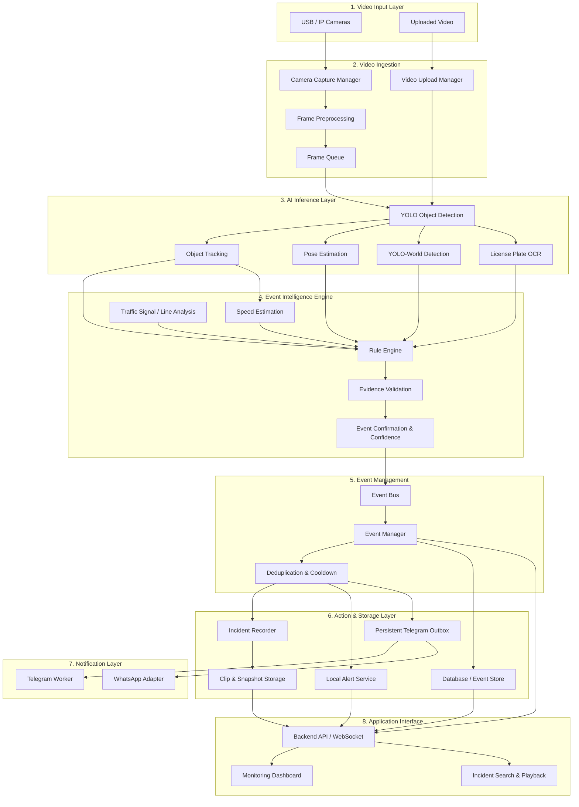

# VisionAI Sentinel

**AI-Assisted Camera Monitoring & Safety Screening Dashboard**

VisionAI Sentinel is a local Windows camera-monitoring dashboard that combines real-time object detection, evidence-based safety screening, incident recording and playback, uploaded-video analysis, and scheduled Telegram delivery of violation clips.

## Features

- **Live camera monitoring:** USB-camera preview with simultaneous object detection and colored bounding boxes.
- **AI object detection:** Primary YOLO detection, optional YOLO-World open-vocabulary detection, and private reference-image matching.
- **Evidence-based event screening:** Eligible live-camera events require continuous evidence before confirmation.
- **Incident recording:** Event-specific clips with preceding and follow-up footage.
- **Incident search and playback:** Searchable local records, object snapshots, and browser-based incident playback.
- **Uploaded-video analysis:** Screening for possible helmet issues, license-plate OCR, red-light crossings, and estimated vehicle speed.
- **Local alerts:** Safety radar, warning messages, spoken warnings, and siren controls.
- **Telegram integration:** Pending violation clips are delivered in batches, with captions.
- **Dashboard assistant:** Supported local commands and optional Telegram command interaction.
- **Optional WhatsApp integration:** Separate setup and status support.

## System Architecture

 
## System Architecture

The following diagram illustrates the complete system architecture of VisionAI Sentinel, including video ingestion, AI inference, event intelligence, event management, incident storage, notification delivery, and dashboard integration.



## Technology Stack

| Component | Technology |
|---|---|
| Object detection | Ultralytics YOLO |
| Optional open-vocabulary detection | YOLO-World |
| Pose screening | YOLO Pose |
| Image-reference matching | CLIP |
| Computer vision | OpenCV |
| Deep learning | PyTorch |
| License-plate OCR | EasyOCR |
| Backend / dashboard | Python |
| Messaging | Telegram Bot API |
| Optional messaging | WhatsApp integration |

## Requirements

- Windows 64-bit
- Python 3.10 or newer (compatible package versions required)
- USB camera and camera permissions
- Speaker for audible warnings (optional)
- Modern web browser
- Internet access for initial dependency/model downloads and messaging integrations
- Adequate RAM, disk space, and CPU/GPU resources

## Installation & Quick Start

### 1. Clone the repository

```bash
git clone https://github.com/YOUR_USERNAME/visionai-sentinel.git
cd visionai-sentinel
```

Replace `YOUR_USERNAME` with your GitHub username.

### 2. Create a virtual environment (recommended)

```bat
python -m venv .venv
.venv\Scripts\activate
```

### 3. Install dependencies

```bat
python -m pip install --upgrade pip
python -m pip install -r requirements.txt
```

### 4. Download model weights

```bat
python download_models.py
```

### 5. Launch the dashboard

```bat
python app.py
```

Open the dashboard in your browser:

**http://localhost:8080**

Select the appropriate camera and start monitoring after model warm-up.

### Alternative Windows Setup

You can also use the included scripts:

```bat
install_windows.bat
start_app.bat
```

## Model Weights

Model binaries are intentionally excluded from this repository. Download them after installation:

```bat
python download_models.py
```

| Model / File | Purpose |
|---|---|
| `yolo26n.pt` | Primary object detection |
| `yolo11n.pt` | Uploaded-video detection |
| `yolo26n-pose.pt` | Optional pose-based screening |
| `yolov8s-worldv2.pt` | Optional open-vocabulary detection |
| `weights/clip/ViT-B-32.pt` | Optional reference-image matching |
| `weights/license_plate_yolo11n.pt` | Uploaded-video license-plate detection |

Some features require optional models. Check the dashboard readiness indicators to confirm which capabilities are active.

## Telegram Setup

Run the local setup utility:

bat
python setup_telegram.py


Provide your own Telegram bot token and destination through the setup flow. Start a conversation with your bot before using it.

### Automatic Delivery Policy

- Confirmed automatic camera events are recorded locally first.
- Pending violation clips are sent in Telegram batches every three minutes while the application is running.
- Each clip is sent as an individual video with its own caption.
- Failed deliveries remain pending for a later retry.
- The outbox persists locally across application restarts.
- **Send Pending Batch Now** allows manual delivery.
- Informational readings do not automatically create violation messages.

Telegram delivery is best-effort. Network timeouts can occasionally cause duplicate delivery.

## Optional WhatsApp Setup

```bat
python setup_whatsapp.py
```

WhatsApp integration requires its own provider/account configuration. Automatic Telegram batching does not enable automatic WhatsApp delivery.

## Live Event Screening

Eligible live-camera events use continuous evidence confirmation to reduce single-frame false positives.

Examples include:

- Demo perimeter occupancy
- Queue congestion
- Phone presence at a demo desk
- Unattended floor objects
- Possible fall screening
- Raised-arm interaction screening
- Frame-edge dwell

Most configured events use a 12-second evidence window; frame-edge dwell uses 15 seconds.

> These are screening conditions, not proof of unsafe behavior, intent, or identity. Demo zones must be configured and validated for the deployment site.

## Uploaded-Video Screening

The uploaded-video module can screen for:

- Possible helmet issues
- License-plate detection and OCR
- Red-light crossing events
- Estimated vehicle speed

These results are uncalibrated estimates and must not be treated as certified traffic-enforcement measurements.

## Configuration

Optional environment variables can be set in Windows Command Prompt:

```bat
set VISIONAI_PORT=8080
set VISIONAI_NO_BROWSER=1
python app.py
```

The application may select another port if the requested port is unavailable. Check the startup output for the actual address.

Private reference images and metadata belong in the local `reference_objects/` directory. Do not upload private reference images, footage, credentials, or runtime data.

## Project Structure

```text
visionai-sentinel/
├── app.py
├── vision_detection.py
├── micro_object_ai.py
├── emergency_action_detector.py
├── object_tracker.py
├── uploaded_video_analysis.py
├── telegram_listener.py
├── whatsapp_manager.py
├── speaker_alarm.py
├── setup_telegram.py
├── setup_whatsapp.py
├── download_models.py
├── requirements.txt
├── test_alert_policy.py
├── THIRD_PARTY_NOTICES.md
├── install_windows.bat
├── start_app.bat
└── README.md
```

## Tests

Run the alert-policy regression tests:

```bat
python -B -m unittest discover -s . -p "test_alert_policy.py"
```

The tests cover alert batching, retry behavior, queue persistence, event thresholds, evidence gaps, subject changes, pose confirmation, and recording metadata.

These tests do not establish real-world detection accuracy or guarantee successful live Telegram delivery. Supervised testing with representative footage is required before deployment.

## Privacy & Security

- Obtain appropriate consent and legal authority before camera monitoring or transmitting footage.
- Never commit bot tokens, credentials, private images, videos, snapshots, or runtime configuration.
- Review `.gitignore` before committing.
- Rotate credentials immediately if they are accidentally exposed.
- The built-in HTTP server does not provide production authentication, TLS, or access control.
- **Do not expose the dashboard directly to the public internet or an untrusted network.**
- Define recording retention, deletion, backup, and operator-access policies.
- Validate camera placement, lighting, zones, thresholds, and detection performance at the deployment site.

## Limitations & Disclaimer

- AI detection may produce false positives and false negatives.
- Camera quality, lighting, occlusion, and hardware affect performance.
- Tracking is geometric and is not biometric identity recognition.
- Evidence confirmation can reduce transient false positives but may delay or miss brief events.
- Speed, OCR, helmet, and traffic-event results are screening estimates.
- Human review is required before any consequential decision.
- This project is not a substitute for emergency response, certified safety equipment, or professional legal/traffic enforcement systems.

## Third-Party Notices

Review [`THIRD_PARTY_NOTICES.md`](THIRD_PARTY_NOTICES.md) for model attribution and licensing information.

Review all dependency and model licenses before commercial use, redistribution, or deployment.

## Contributing

Contributions, bug reports, and suggestions are welcome. Please:

1. Describe the issue or proposed change clearly.
2. Include reproducible steps where possible.
3. Avoid sharing credentials, private footage, or personal data.
4. Test changes before submitting a pull request.

## License

Add a project license before distributing this repository. Third-party libraries and model weights have their own license terms; see `THIRD_PARTY_NOTICES.md`.

---

**VisionAI Sentinel** — AI-assisted monitoring, evidence-based screening, and incident review.
